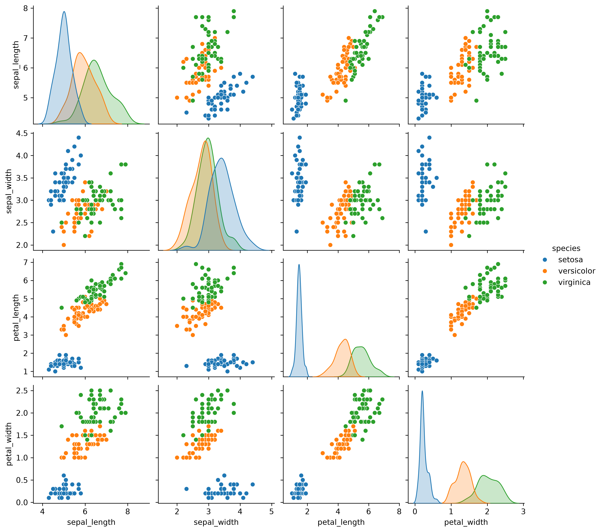
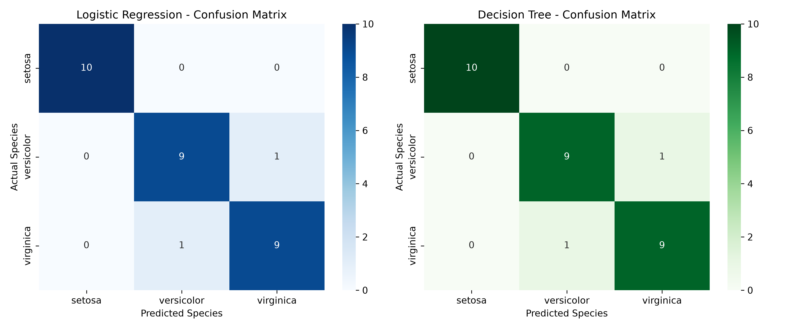
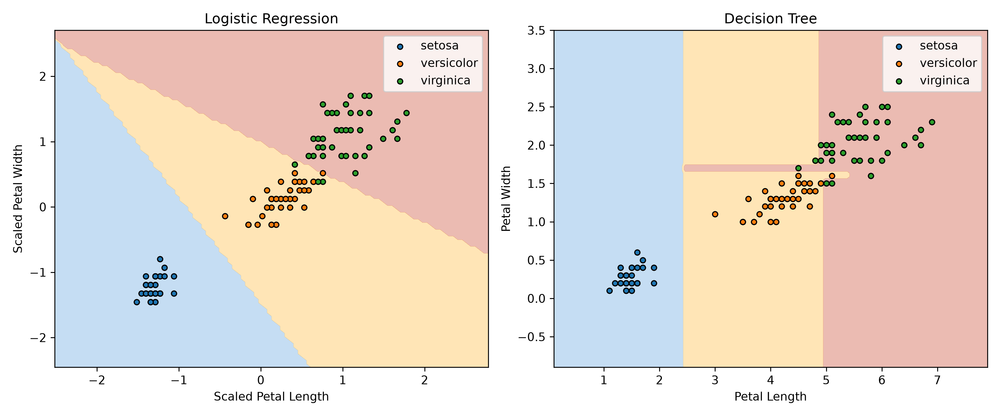

# Multi-Class Benchmark Classification Pipeline (Iris / Wine)

**Task 1 | Datheon Machine Learning & Data Science Internship**

## Project Overview

This project implements an end-to-end supervised machine learning classification pipeline using the Iris dataset. The objective is to classify Iris flowers into three species: **Setosa, Versicolor, and Virginica**.

Two machine learning algorithms, **Logistic Regression** and **Decision Tree Classifier**, are trained and evaluated to compare their classification performance.

## Dataset

The Iris dataset contains **150 samples**, four numerical input features, and one target variable.

| Feature | Description |
|---|---|
| Sepal Length | Length of the flower's sepal |
| Sepal Width | Width of the flower's sepal |
| Petal Length | Length of the flower's petal |
| Petal Width | Width of the flower's petal |
| Species | Target variable |

The dataset contains 50 samples for each of the three species and has no missing values.

## Technologies Used

- Python
- Pandas
- Scikit-learn
- Seaborn
- Matplotlib
- Jupyter Notebook

## Project Workflow

1. **Data Loading:** Load the Iris dataset using Pandas.
2. **Exploratory Data Analysis:** Examine dataset structure, missing values, and class distribution.
3. **Data Visualization:** Analyze feature relationships using Seaborn pairplots.
4. **Data Preprocessing:** Perform an 80/20 stratified train-test split and apply StandardScaler.
5. **Model Training:** Train Logistic Regression and Decision Tree classifiers.
6. **Model Evaluation:** Calculate accuracy, precision, recall, F1-score, and classification reports.
7. **Visualization:** Generate confusion matrix heatmaps and decision boundary plots.
8. **Model Comparison:** Compare the performance of both classifiers.

## Machine Learning Models

### Logistic Regression

Logistic Regression is trained using standardized numerical features. It learns linear decision boundaries to classify Iris flowers into three species.

### Decision Tree Classifier

Decision Tree is trained using the original numerical features. It makes predictions using feature-based decision rules and does not require feature scaling.

## Model Performance

Both models achieved the following results on the test dataset:

| Model | Accuracy | Precision | Recall | F1-Score |
|---|---:|---:|---:|---:|
| Logistic Regression | 93.33% | 93.33% | 93.33% | 93.33% |
| Decision Tree | 93.33% | 93.33% | 93.33% | 93.33% |

**Both models correctly classified 28 out of 30 test samples.**

Precision, recall, and F1-score are reported using weighted averages.

## Visualizations

### 1. Iris Dataset Pairplot

The pairplot illustrates relationships between numerical features and highlights the distribution of the three Iris species.



### 2. Confusion Matrix Heatmaps

The confusion matrix heatmaps visualize correct and incorrect predictions for Logistic Regression and Decision Tree.



### 3. Decision Boundary Visualization

The decision boundary plots illustrate how the two algorithms separate Iris species using petal length and petal width.



The decision boundaries are generated using separate two-feature models for visualization purposes.

## Key Findings

- Both classifiers achieved **93.33% accuracy** on the test dataset.
- Setosa was correctly classified in all test samples.
- Minor classification errors occurred between Versicolor and Virginica.
- Petal length and petal width were useful features for distinguishing Iris species.
- Logistic Regression produced linear decision boundaries, while Decision Tree generated rectangular decision regions.

## Project Structure

```text
Task_1_Iris_Classification/
│
├── README.md
├── iris_classification.ipynb
├── iris.csv
│
├── iris_pairplot.png
├── confusion_matrices.png
└── decision_boundaries.png
```

## How to Run

1. Download or clone the repository.
2. Install the required libraries:

   ```bash
   pip install pandas seaborn matplotlib scikit-learn jupyter
   ```

3. Open `iris_classification.ipynb` in Jupyter Notebook or VS Code.
4. Ensure `iris.csv` is in the same directory as the notebook.
5. Select a Python kernel with the required libraries installed.
6. Run all notebook cells to reproduce the results and visualizations.

## Conclusion

This project demonstrates a complete supervised machine learning workflow, including data exploration, preprocessing, model training, evaluation, and visualization.

Both Logistic Regression and Decision Tree achieved **93.33% classification accuracy** on the Iris dataset. The results demonstrate that different classification algorithms can achieve comparable predictive performance.

---

**Datheon Machine Learning & Data Science Internship | Task 1**